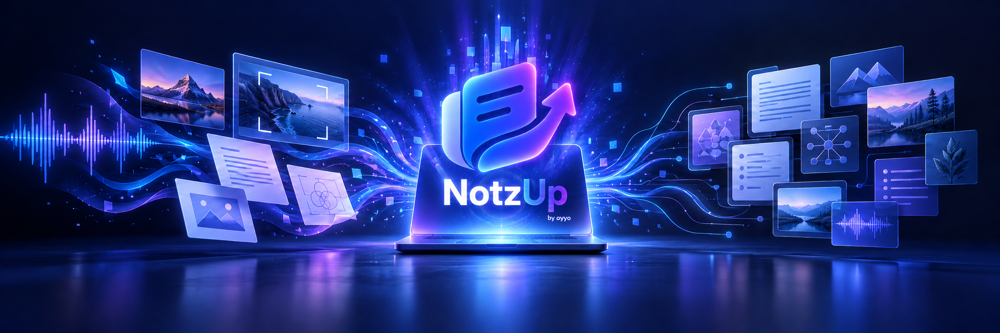

<div align="center">



# OYYO NotzUP

## Private capture, audio and music analysis, visual understanding and offline transcription in one workspace

**Capture anything. Understand it locally.**

[](https://apps.microsoft.com/detail/9NX0604FJ0XN)
[-2563EB?style=for-the-badge&logo=windows11&logoColor=white)](https://github.com/vpicciuolo/oyyo-notzup/releases/tag/v1.0.0-windows)
[](https://github.com/vpicciuolo/oyyo-notzup/releases/tag/v0.1.0-alpha.1-macos)
[](https://github.com/vpicciuolo/oyyo-notzup/releases/tag/v1.0.0-android)
[](https://snapcraft.io/oyyo-notzup)
[](https://github.com/vpicciuolo/oyyo-notzup/releases/tag/v1.0.0-linux)
[](https://github.com/vpicciuolo/oyyo-notzup/releases)

[Download options](docs/DOWNLOADS.md) · [Complete feature guide](docs/FEATURES.md) · [User guide](docs/USER_GUIDE.md) · [Offline translation and accessibility](docs/OFFLINE_TRANSLATION_AND_ACCESSIBILITY.md) · [Mobile barcode inventory](docs/MOBILE_BARCODE_INVENTORY.md) · [Booking pages](docs/PUBLIC_BOOKING_PAGES.md) · [Encrypted backup and storage](docs/ENCRYPTED_BACKUP_AND_STORAGE.md) · [Local-first privacy](docs/LOCAL_FIRST_PRIVACY.md) · [Windows Store](https://apps.microsoft.com/detail/9NX0604FJ0XN) · [Snap Store](https://snapcraft.io/oyyo-notzup) · [Android 1.0.0 pre-release](https://github.com/vpicciuolo/oyyo-notzup/releases/tag/v1.0.0-android) · [NotzUP website](https://notzup.com/) · [Help & FAQ](docs/FAQ.md) · [Support](mailto:support@oyyo.one)


</div>

OYYO NotzUP is the private capture and knowledge workspace inside **[OYYO ONE AI](https://oyyo.one/)** for Windows, macOS, Linux, Android and iOS. Record audio or a permitted screen, save screenshots, scan with the camera, import documents, images, music and video, or keep text and links. Then use on-device intelligence to transcribe speech, draft lyrics or spoken words, analyze music and sound, describe visuals, translate, search, summarize and turn each source into useful, reviewable work. Local originals remain under your control and stay on your device unless you explicitly choose a connected or online feature.

**Local OYYO AI Core — running privately on your device.**

> Official direct downloads appear only on the [GitHub Releases page](https://github.com/vpicciuolo/oyyo-notzup/releases). The Microsoft Store package is signed by Microsoft. Windows 1.0.0 direct EXE/MSI files are unsigned and can trigger Microsoft Defender SmartScreen. The macOS `0.1.0-alpha.1` test DMG is ad-hoc signed, not notarized by Apple, and can be blocked by Gatekeeper until the user explicitly approves it. Never trust an installer copied to an unofficial host.

## Why NotzUP

- **A mobile barcode inventory, not a basic code reader:** Pro and Organization users can scan only on demand, run a controlled counting session, import a CSV or Excel catalog, compare expected and counted quantities, and export CSV, Excel or a printable PDF. This capability is exclusive to the mobile app and is currently available on Android.
- **More than a screen recorder:** audio, screen, screenshot, scan, file and text capture live together.
- **Private local intelligence:** supported transcription, OCR, search and grounded outputs run on the device, without a hidden cloud-model fallback.
- **A searchable source library:** find relevant transcript passages and return to their timestamped source context.
- **Useful outputs you control:** review summaries, explanations, actions, Markdown and JSON before exporting or sharing.
- **Audio and music understanding:** create review drafts of lyrics or spoken words and inspect duration, sample rate, channels, estimated tempo, tonal estimate and dynamic range.
- **Grounded visual understanding:** use a compatible verified local vision pack for scene descriptions, alt text and approved object labels.
- **Context-aware offline translation:** choose a destination language, keep paragraphs and lists together, and select faithful or natural-context output. English and Italian also include a light playful style; Italian adds clearly labelled beta Napoletano and Barese profiles. A correction you review and approve can be reused privately on that device.
- **Accessible review:** listen to a result with an installed offline Android voice, use screen readers and keep Android display and font scaling.
- **Adaptive Android layout:** use NotzUP on touch phones, tablets and foldables. Google TV is not supported.
- **Real provider consent:** connect supported Google, Microsoft, Zoom and Slack services only when you choose.
- **A personal public booking page:** every user can share a personal meeting link, define availability, duration, buffers and minimum notice, and let guests choose a time in their own time zone.
- **Fast access:** desktop controls, tray/menu-bar actions, Android Quick Settings and purpose-built widgets keep capture close.
- **Encrypted backup with your recovery key:** supported result and inventory backups are encrypted on the device before upload. The recovery key is controlled by the user and is never sent to NotzUP.
- **One storage pool across authorized devices:** personal and Organization spaces keep separate quotas, while authorized mobile and desktop installations can use the same selected space and restore a dated backup from another device.

## Mobile-exclusive barcode and QR inventory

The Android mobile app includes a purpose-built barcode and QR inventory workspace for **Pro and Organization** plans. Nothing is counted until the user taps **Scan one**, unless they deliberately start controlled automatic scanning. The manual and automatic controls stay beside the camera on phones; tablets and foldables use a two-column camera-and-results layout. Repeated codes increase the quantity instead of creating an unreadable list.

Inventory teams can import a CSV, XLS or XLSX catalog with description, article ID, barcode, expected quantity, location and unit. NotzUP then shows expected quantity, scanned quantity, difference, match status and unknown scanned items. Results can be exported as CSV for warehouse updates, Excel with detailed and totals sheets, or a branded printable PDF.

A single scan can be copied or used to start an online product search. The scanner supports configurable profiles for retail codes, QR codes, warehouse codes and all supported formats. The full workflow is documented in the [Mobile Barcode and QR Inventory guide](docs/MOBILE_BARCODE_INVENTORY.md).

## Encrypted cloud backup and storage

Cloud storage is optional. When encrypted backup is enabled, NotzUP encrypts the selected result or inventory on the device before it is uploaded. Encryption setup requires account two-factor authentication. The recovery key can be downloaded, imported and managed by the user; NotzUP does not receive it and cannot recreate it. If every copy is lost, existing encrypted backups are permanently unreadable.

Personal and Organization storage spaces have independent shared quotas. Every authorized installation using the selected space can see its stored backup list, subject to account and workspace permissions. A new installation can import the matching recovery key, choose a dated backup created by another authorized device, and restore it as a local copy. See [Encrypted Backup and Cloud Storage](docs/ENCRYPTED_BACKUP_AND_STORAGE.md).

## Personal meeting and appointment pages

Every user can create a personal public page and shareable link for meetings and appointments. Guests see available times in their own time zone and do not need a NotzUp account to choose a slot. Users control availability, duration, buffers and minimum notice, and can confirm, reschedule or cancel a booking. Confirmations can include an `.ics` file and a private management link where supported.

External calendars affect availability only after the user authorizes the provider and the connector is configured. A booking never grants permission to record the meeting. See [Personal Booking Pages and Meeting Links](docs/PUBLIC_BOOKING_PAGES.md).

## Windows features

- Microphone audio recording and eligible Windows system-audio capture
- Screen/window recording through the Windows permission flow
- Screenshot capture and supported local OCR
- Broad PDF, Office, OpenDocument, text, image, audio and video import
- Offline speech transcription with a verified local model
- Review drafts of lyrics or spoken words from audio you are authorized to analyze
- Local music and sound facts including tempo, tonal estimate and dynamic range
- Grounded scene descriptions, alt text and approved object labels with a compatible local vision pack
- Offline translation with installed language packs, paragraph-aware natural context and reviewed local correction memory
- Local transcript search with source context and citations
- Reviewable summaries, explanations, action items, Markdown and JSON
- Local SQLite metadata and OS application-data storage
- System-language detection plus an in-app language selector
- Consent-controlled privacy-safe analytics that excludes captured content

Feature availability depends on the operating system, hardware, source application, provider scopes and installed local models. Mobile operating systems can restrict capture of protected, cellular and third-party app audio.

## Download and verify

The [Download options](docs/DOWNLOADS.md) page is the canonical availability list. It keeps the Store and direct-download routes separate so you can choose the installation method that fits your device.

| Platform | Store channel | Direct GitHub download | Current availability |
| --- | --- | --- | --- |
| Windows 10/11 x64 | [Microsoft Store](https://apps.microsoft.com/detail/9NX0604FJ0XN) | [Setup EXE](https://github.com/vpicciuolo/oyyo-notzup/releases/download/v1.0.0-windows/OYYO-NotzUP-1.0.0-Windows-x64-Setup.exe) · [MSI](https://github.com/vpicciuolo/oyyo-notzup/releases/download/v1.0.0-windows/OYYO-NotzUP-1.0.0-Windows-x64.msi) | **Store available**; direct installers are unsigned and require manual approval on some PCs |
| macOS 10.15+; Intel or Apple silicon | Mac App Store after review | [Universal test DMG](https://github.com/vpicciuolo/oyyo-notzup/releases/download/v0.1.0-alpha.1-macos/OYYO-NotzUP-0.1.0-alpha.1-macOS-universal-test.dmg) | **Test pre-release available**; ad-hoc signed and not notarized; manual Gatekeeper approval required |
| Android | Google Play (closed testing/review) | [Signed arm64 APK](https://github.com/vpicciuolo/oyyo-notzup/releases/download/v1.0.0-android/OYYO-AI-NotzUP-Android-1.0.0-arm64-v8a.apk) or [universal APK](https://github.com/vpicciuolo/oyyo-notzup/releases/download/v1.0.0-android/OYYO-AI-NotzUP-Android-1.0.0-universal.apk) | Signed 1.0.0 pre-release available; Play build 1000025 is in closed-test review and production access is not yet available |
| iPhone and iPad | Apple App Store | No public sideload package | In preparation |
| Linux x64 | [Snap Store — latest/edge](https://snapcraft.io/oyyo-notzup) | [AppImage](https://github.com/vpicciuolo/oyyo-notzup/releases/download/v1.0.0-linux/OYYO-NotzUP-1.0.0-Linux-x86_64.AppImage) · [DEB](https://github.com/vpicciuolo/oyyo-notzup/releases/download/v1.0.0-linux/OYYO-NotzUP-1.0.0-Linux-x86_64.deb) · [RPM](https://github.com/vpicciuolo/oyyo-notzup/releases/download/v1.0.0-linux/OYYO-NotzUP-1.0.0-Linux-x86_64.rpm) · [CLI](https://github.com/vpicciuolo/oyyo-notzup/releases/download/v1.0.0-linux/OYYO-NotzUP-CLI-1.0.0-Linux-x86_64.tar.gz) | **Snap Store edge release available**; unsigned direct packages passed VM validation; physical Linux permission QA remains |

The Microsoft Store and Snap Store links are the recommended Store routes for their platforms. OYYO NotzUP is currently published to Snap's `latest/edge` channel while physical Linux permission QA continues. The Windows direct installers are provided for users who explicitly prefer a traditional setup wizard or MSI and understand that version 1.0.0 is not Authenticode-signed.

### Install Windows from the command line

Windows users can install the same Microsoft-signed Store package without opening the Store UI:

```powershell
winget install 9NX0604FJ0XN --source msstore --accept-package-agreements --accept-source-agreements
```

This command downloads OYYO AI NotzUP directly from Microsoft and avoids the warning shown by the unsigned direct installers.

### Install Linux from the Snap Store

The public [Snap Store listing](https://snapcraft.io/oyyo-notzup) provides the GUI and the `oyyo-notzup.cli` command. Version 1.0.0 is currently in the `latest/edge` channel, so install it explicitly with:

```bash
sudo snap install oyyo-notzup --edge
```

The edge channel is the tested pre-stable Store channel and receives automatic Snap updates. Use the [Linux installation guide](docs/INSTALL_LINUX.md) for permissions, direct packages and CLI details.

### Install the macOS test build

Download the [universal macOS test DMG](https://github.com/vpicciuolo/oyyo-notzup/releases/download/v0.1.0-alpha.1-macos/OYYO-NotzUP-0.1.0-alpha.1-macOS-universal-test.dmg) and its [SHA-256 manifest](https://github.com/vpicciuolo/oyyo-notzup/releases/download/v0.1.0-alpha.1-macos/SHA256SUMS-macos.txt). This is an early functional-test build for Intel and Apple silicon Macs running macOS 10.15 or later. It is ad-hoc signed and has not been notarized by Apple.

Verify, install and open it only if the checksum matches:

```bash
shasum -a 256 OYYO-NotzUP-0.1.0-alpha.1-macOS-universal-test.dmg
```

Expected SHA-256:

```text
1cfb137867c6c452df3f8461e3c6d5ce90c1dc6bd4d852095021d564b905d8eb
```

Double-click the DMG, drag **OYYO NotzUP** to **Applications**, eject the disk image, then open the app from Applications. If Gatekeeper blocks this non-notarized test build, first verify the checksum and release URL, try to open the app once, then use **System Settings → Privacy & Security → Open Anyway**. Do not override a malware, damaged-app or checksum warning. See the complete [macOS installation and first-run guide](docs/INSTALL_MACOS.md).

### Install Windows with the traditional setup wizard

Download the [version 1.0.0 Setup EXE](https://github.com/vpicciuolo/oyyo-notzup/releases/download/v1.0.0-windows/OYYO-NotzUP-1.0.0-Windows-x64-Setup.exe). It is the normal guided installer and includes the required WebView2 runtime for offline installation. The alternative [MSI](https://github.com/vpicciuolo/oyyo-notzup/releases/download/v1.0.0-windows/OYYO-NotzUP-1.0.0-Windows-x64.msi) is intended for traditional or managed deployment.

Version 1.0.0 direct Windows installers are **not Authenticode-signed**. If Microsoft Defender SmartScreen appears, confirm that the file came from this repository, compare its SHA-256 checksum with the release checksum file, select **More info**, verify the displayed app name, and choose **Run anyway** only if you accept the unsigned-install risk. The dialog cannot show HRN INNOVATION TECHNOLOGIES LTD as a verified publisher until a trusted organization-validation certificate is available.

Every direct desktop release will include:

1. A versioned, immutable GitHub Release asset.
2. The signature status and any operating-system warning are disclosed beside the download.
3. SHA-256 checksums and release notes.
4. A statement of supported operating-system versions and architectures.
5. Stable file naming for MSI, EXE, DMG, APK, AppImage, DEB and CLI packages where applicable.

## Quick start

1. Install Windows from the [Microsoft Store](https://apps.microsoft.com/detail/9NX0604FJ0XN), install the [macOS test build](docs/INSTALL_MACOS.md), or choose another live package on the [Download options](docs/DOWNLOADS.md) page.
2. Verify every direct download against the checksum in its tagged release. Review the disclosed unsigned or non-notarized status before manually overriding SmartScreen or Gatekeeper.
3. Open NotzUP and approve only the microphone, screen, camera or notification permissions needed for the capture you choose.
4. Allow the verified local speech model to download and pass integrity verification on first use.
5. Select **Capture anything**, choose a source, name the session and start.
6. Stop and save, then review the original, transcript and selected outputs in **Library**.

See the detailed [Getting Started guide](docs/GETTING_STARTED.md), [Windows installation guide](docs/INSTALL_DESKTOP.md), and [macOS installation guide](docs/INSTALL_MACOS.md).

For a feature-by-feature walkthrough, use the [Complete User Guide](docs/USER_GUIDE.md). It covers capture, import, playback, transcription, visual analysis, file workspaces, exports, barcode inventory, encrypted backup, notifications, sharing, calendars, connectors and troubleshooting.

## Common workflows

### Record and transcribe a meeting without a bot

Choose **Audio** for microphone capture or **Screen recording** when you need a permitted app/window and eligible system audio. Keep the recording indicator visible, stop and save, then run the verified local transcription model. Always obtain participant consent and follow applicable recording law and workplace policy.

### Turn a document or screenshot into useful notes

Choose **Screenshot**, **Scan** or **Import a file**. Select the outputs you want—such as extracted text, summary, explanation, actions or Markdown—and review the evidence before exporting.

### Analyze audio and music locally

Import audio or music you are permitted to analyze. NotzUP can create a tentative lyrics or spoken-word draft and report grounded sound facts such as duration, sample rate, channels, estimated tempo, tonal estimate and dynamic range. Review every draft against the original: sung-word recognition can be unreliable over instruments or background audio, and NotzUP does not fetch or reproduce third-party lyrics catalogs.

### Describe visuals and translate offline

Open an imported image, screenshot or camera scan with a compatible verified local vision pack to produce a scene description, alt text and approved object labels. Installed language packs can translate supported outputs without sending the captured source to a cloud inference service.

Choose **Faithful** for a direct translation or **Natural context** to keep passages, headings, lists and punctuation together. English and Italian add a light playful profile. Italian also offers experimental Napoletano and Barese style profiles, clearly labelled beta and intended for review rather than as a substitute for a native speaker. Edit and approve a correction when you want NotzUP to reuse that exact source, language and style result from private on-device memory. See [Offline Translation, Read-Aloud and Accessibility](docs/OFFLINE_TRANSLATION_AND_ACCESSIBILITY.md).

### Read a result aloud and use accessibility tools

Open a populated result section and choose **Listen aloud**. NotzUP selects only an installed offline Android voice and asks you to install one when the detected language has none. **Stop reading** ends playback. The Android app follows the device's display and font-size settings and exposes spoken labels for primary controls. The touch interface adapts to phones, tablets and foldables; Google TV is intentionally excluded.

### Summarize any supported source

From the source result, choose the outputs you need: summary, explanation, action items, clean text, Markdown or structured JSON. Each output stays tied to the source so you can review it before exporting or sharing.

### Search your private capture library

Open **Library** and search for a person, phrase, decision or topic. NotzUP searches supported local transcript text and surrounding passages on the device.

### Connect a calendar or content service

Open **Connectors**, select a provider and review the requested permissions. The provider’s OAuth screen controls consent. Available data depends on the scopes and administrator policy for that account.

## Privacy at a glance

- Local recordings and imported media remain on the device unless you explicitly choose an online feature.
- Supported local processing is performed on the device.
- Optional synced storage is separate from local capture and is user controlled.
- Analytics is opt-in/choice controlled and excludes recordings, transcripts, notes, searches, file names, calendar details and account details.
- NotzUP does not silently create provider connections or bypass operating-system capture controls.

The detailed [Local-First Privacy and Data Control guide](docs/LOCAL_FIRST_PRIVACY.md) explains exactly which actions can send selected data outside the device.

[Privacy Policy](https://oyyo.one/privacy) · [Terms of Service](https://oyyo.one/terms) · [Security reporting](SECURITY.md)

## Support

- Product help: [NotzUP FAQ](docs/FAQ.md)
- Email: [support@oyyo.one](mailto:support@oyyo.one)
- Bugs and feature requests without private data: [GitHub Issues](https://github.com/vpicciuolo/oyyo-notzup/issues)
- Security concerns: follow [SECURITY.md](SECURITY.md); do not post secrets, recordings or personal data in a public issue.

## Product and publisher

OYYO NotzUP is developed as part of **[OYYO ONE AI](https://oyyo.one/)** by **[HRN INNOVATION TECHNOLOGIES LTD](https://hrn.ae/)**. NotzUP is not affiliated with Google, Microsoft, Zoom, Slack, OpenAI or Anthropic. Provider names and marks identify optional compatible integrations and remain the property of their respective owners.

**[© 2026 HRN INNOVATION TECHNOLOGIES LTD](https://hrn.ae/)**


